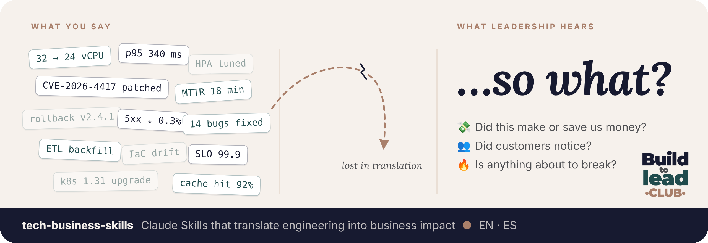

<div align="center">



**[🇺🇸 English 🇬🇧](#english)** · **[🇪🇸 Español 🌎](#espanol)**

</div>

---

<a id="english"></a>

<div align="center">

# 🇺🇸 English 🇬🇧

## Turn your technical work into<br>the language leadership acts on.

Claude Skills that translate engineering into what the business cares about:<br>
**money, customers and risk.** In English or Spanish. No made-up numbers.

**[⚡ Install in 1 minute](#install-en)** · [🧰 See the skills](#-pick-a-skill)

</div>

<br>

| 😬 What you wrote | 🎯 What leadership reads |
|---|---|
| *Downsized main DB from 32 to 24 vCPU on Oct 11. 2h maintenance window. Saves ~USD 1,200/month.* | 🟢 **[HIGHLIGHT] Infrastructure optimization:** On Oct 11, the SRE team reduced our main database by 25%, saving USD 1,200/month (≈ USD 14,400/year) in a planned 2-hour maintenance window.<br>**Owner:** SRE team |

<p align="center"><b>Same work. Now the CFO gets it.</b></p>

## 🧰 Pick a skill

<table>
<tr>
<td width="50%" valign="top">

### 📄 Short report

One technical topic → one **3–4 line business update** with a traffic light, a number and an owner.

*Status updates, incidents, risks.*

**[See it in action →](tech-to-business-short-report/README.md)**

</td>
<td width="50%" valign="top">

### 🎯 SMART objectives

One technical initiative → one **quarterly objective** leadership can approve and track.

*OKRs, Q planning, goals.*

**[See it in action →](tech-to-business-smart-objectives/README.md)**

</td>
</tr>
<tr>
<td width="50%" valign="top">

### 📘 FAQ one-pager

Something new you built → one **friendly page of FAQs** as an editable Word document.

*Launches, onboarding, "how this works".*

**[See it in action →](tech-to-business-faq-one-pager/README.md)**

</td>
<td width="50%" valign="top">

### 🎤 Interviews

One role to hire → **20 technical questions** that reveal business thinking, with STAR, as a fillable PDF.

*Hiring for business sense, scorecards.*

**[See it in action →](tech-to-business-interviews/README.md)**

</td>
</tr>
<tr>
<td width="50%" valign="top">

### 🧪 Tech interviews

One role to hire → **20 questions, 80% technical**: fundamentals, troubleshooting, an architecture exercise. Fillable PDF.

*Technical screens, system design.*

**[See it in action →](tech-interviews/README.md)**

</td>
<td width="50%" valign="top">

### 💡 Your idea

Missing a skill? Tell us what you'd like to translate next.

*Every new skill arrives on its own once installed.*

**[Open an issue →](../../issues)**

</td>
</tr>
</table>


## 👋 Always start with your role

> [!IMPORTANT]
> Begin every message with **"I'm a…"** or **"My role is…"**
>
> *"**I'm a backend developer.** …"* · *"**My role is SRE lead.** …"* · *"**I'm a data engineer.** …"*

Your role decides which numbers matter: adoption and bugs for a developer, availability and cost for SRE, exposure for security. Say it first and you get your answer in one shot. You don't need to name the skill; Claude picks the right one.

<a id="install-en"></a>

## ⚡ Install in Claude

Pick where you use Claude. **The app installs from the screen; commands are only for Claude Code.**

### 💻 Claude app (web or desktop) · no commands

1. Open **[Customize → Plugins](https://claude.ai/customize/plugins)** and click **Add → Add marketplace**.
2. Paste `MaisfloroTech/tech-business-skills`.
3. Find **Tech Business Skills** and click **Add**. ✅

Done. Open a new chat and start with your role. Don't type `/plugin …` in the chat: the app doesn't run install commands.

### ⌨️ Claude Code (terminal) only

```
/plugin marketplace add MaisfloroTech/tech-business-skills
/plugin install tech-business-skills@tech-business-skills
```

<details>
<summary>Other ways to install, and troubleshooting</summary>

<br>

**New skill not in the `/` menu?** Reload the app (Cmd/Ctrl + R) or open a new chat. Still missing? Turn the plugin off and on in **Customize → Plugins**. In Claude Code, run `claude update` if `/plugin` isn't recognized.

**One skill as a zip (web or desktop):** download it from the [latest release](../../releases/latest) without unzipping, then **Customize → Skills → Upload skill**. You'll repeat this for every update.

**One skill folder (Claude Code):**

```bash
git clone https://github.com/MaisfloroTech/tech-business-skills.git
mkdir -p ~/.claude/skills
cp -r tech-business-skills/tech-to-business-short-report ~/.claude/skills/
```

**Plans:** you need Pro, Max, Team or Enterprise. On Team and Enterprise an admin may need to allow marketplaces, and can install it for the whole organization.

</details>

## 🗣️ English or Spanish

Write in English and you get English; write in Spanish and you get Spanish. You can also mix: *"talk to me in Spanish but write the report in English for my global manager"*.

<br>

---

<a id="espanol"></a>

<div align="center">

# 🇪🇸 Español 🌎

🇲🇽 🇨🇴 🇦🇷 🇨🇱 🇵🇪 🇻🇪 🇪🇨 🇧🇴 🇺🇾 🇵🇾 🇨🇷 🇵🇦 🇬🇹 🇭🇳 🇸🇻 🇳🇮 🇨🇺 🇩🇴 🇵🇷

## Convierte tu trabajo técnico en<br>el idioma con el que decide el liderazgo.

Claude Skills que traducen ingeniería a lo que le importa al negocio:<br>
**plata, clientes y riesgo.** En inglés o en español. Sin números inventados.

**[⚡ Instálalo en 1 minuto](#install-es)** · [🧰 Mira los skills](#-elige-un-skill)

</div>

<br>

| 😬 Lo que escribiste | 🎯 Lo que lee el liderazgo |
|---|---|
| *Bajamos la base de datos principal de 32 a 24 vCPU el 11 de octubre. Ventana de mantenimiento de 2 h. Ahorra ~USD 1.200/mes.* | 🟢 **[HIGHLIGHT] Optimización de infraestructura:** El 11 de octubre, el equipo SRE redujo el tamaño de nuestra base de datos principal en 25%, con un ahorro de USD 1.200/mes (≈ USD 14.400/año), en una ventana de mantenimiento planificada de 2 horas.<br>**Responsable:** Equipo SRE |

<p align="center"><b>El mismo trabajo. Ahora el CFO lo entiende.</b></p>

## 🧰 Elige un skill

<table>
<tr>
<td width="50%" valign="top">

### 📄 Reporte corto

Un tema técnico → una **actualización de negocio de 3–4 líneas** con semáforo, un número y un responsable.

*Reportes de estado, incidentes, riesgos.*

**[Míralo en acción →](tech-to-business-short-report/README.md#espanol)**

</td>
<td width="50%" valign="top">

### 🎯 Objetivos SMART

Una iniciativa técnica → un **objetivo trimestral** que el liderazgo puede aprobar y seguir.

*OKRs, planificación del Q, metas.*

**[Míralo en acción →](tech-to-business-smart-objectives/README.md#espanol)**

</td>
</tr>
<tr>
<td width="50%" valign="top">

### 📘 FAQ de una página

Algo nuevo que construiste → una **página amigable de preguntas frecuentes** en un Word editable.

*Lanzamientos, onboarding, "cómo funciona esto".*

**[Míralo en acción →](tech-to-business-faq-one-pager/README.md#espanol)**

</td>
<td width="50%" valign="top">

### 🎤 Entrevistas

Un rol a contratar → **20 preguntas técnicas** que revelan si piensa en negocio, con STAR, en un PDF editable.

*Contratar con foco en negocio, scorecards.*

**[Míralo en acción →](tech-to-business-interviews/README.md#espanol)**

</td>
</tr>
<tr>
<td width="50%" valign="top">

### 🧪 Entrevistas técnicas

Un rol a contratar → **20 preguntas, 80% técnicas**: fundamentos, resolución de problemas, un ejercicio de arquitectura. PDF editable.

*Entrevistas técnicas, diseño de sistemas.*

**[Míralo en acción →](tech-interviews/README.md#espanol)**

</td>
<td width="50%" valign="top">

### 💡 Tu idea

¿Te falta un skill? Cuéntanos qué te gustaría traducir después.

*Cada skill nuevo te llega solo una vez instalado.*

**[Abre un issue →](../../issues)**

</td>
</tr>
</table>


## 👋 Empieza siempre con tu rol

> [!IMPORTANT]
> Empieza cada mensaje con **"Soy…"** o **"Mi rol es…"**
>
> *"**Soy desarrolladora backend.** …"* · *"**Mi rol es líder de SRE.** …"* · *"**Soy líder de datos.** …"*

Tu rol decide qué números importan: adopción y bugs para desarrollo, disponibilidad y costo para SRE, exposición para seguridad. Dilo de entrada y te responde de una, sin preguntas extra. No necesitas nombrar el skill; Claude escoge el correcto.

<a id="install-es"></a>

## ⚡ Instálalo en Claude

Elige dónde usas Claude. **En la app se instala desde la pantalla; los comandos son solo para Claude Code.**

### 💻 App de Claude (web o escritorio) · sin comandos

1. Abre **[Customize → Plugins](https://claude.ai/customize/plugins)** y haz clic en **Add → Add marketplace**.
2. Pega `MaisfloroTech/tech-business-skills`.
3. Busca **Tech Business Skills** y haz clic en **Add**. ✅

Listo. Abre un chat nuevo y empieza con tu rol. No escribas `/plugin …` en el chat: la app no ejecuta comandos de instalación.

### ⌨️ Solo Claude Code (terminal)

```
/plugin marketplace add MaisfloroTech/tech-business-skills
/plugin install tech-business-skills@tech-business-skills
```

<details>
<summary>Otras formas de instalar y solución de problemas</summary>

<br>

**¿El skill nuevo no aparece en el menú `/`?** Recarga la app (Cmd/Ctrl + R) o abre un chat nuevo. ¿Sigue sin aparecer? Apaga y vuelve a prender el plugin en **Customize → Plugins**. En Claude Code, corre `claude update` si no reconoce `/plugin`.

**Un skill como zip (web o escritorio):** descárgalo del [último release](../../releases/latest) sin descomprimirlo y ve a **Customize → Skills → Upload skill**. Tendrás que repetirlo en cada actualización.

**Una carpeta de skill (Claude Code):**

```bash
git clone https://github.com/MaisfloroTech/tech-business-skills.git
mkdir -p ~/.claude/skills
cp -r tech-business-skills/tech-to-business-short-report ~/.claude/skills/
```

**Planes:** necesitas Pro, Max, Team o Enterprise. En Team y Enterprise puede que un admin tenga que permitir marketplaces, y puede instalarlo para toda la organización.

</details>

## 🗣️ Inglés o español

Si le escribes en español, te responde en español; si le escribes en inglés, en inglés. También puedes mezclar: *"háblame en español pero el reporte en inglés para mi jefe global"*. Las etiquetas del semáforo (HIGHLIGHT, LOWLIGHT, RISK) quedan en inglés por defecto porque son vocabulario común entre equipos; si las quieres traducidas, pídelo.

<br>

---

<div align="center">

**Teams:** click **Use this template** for a private copy with your own examples · **Contribute:** [CONTRIBUTING.md](CONTRIBUTING.md)<br>
**Equipos:** usa **Use this template** para una copia privada con tus propios ejemplos · **Contribuye:** [CONTRIBUTING.md](CONTRIBUTING.md)

⭐ If this helped you sound more like business and less like a changelog, give it a star.<br>
⭐ Si te ayudó a sonar más a negocio y menos a changelog, déjale una estrella.

Made with ☕ by [@maisfloro.tech](https://www.maisfloro.com/)

</div>
