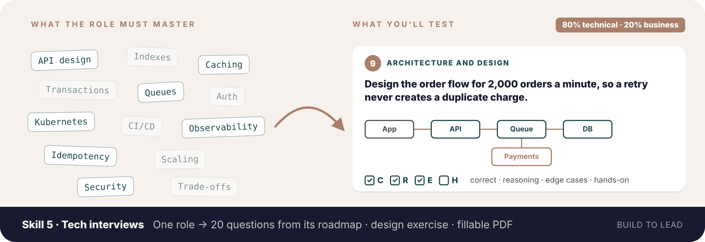
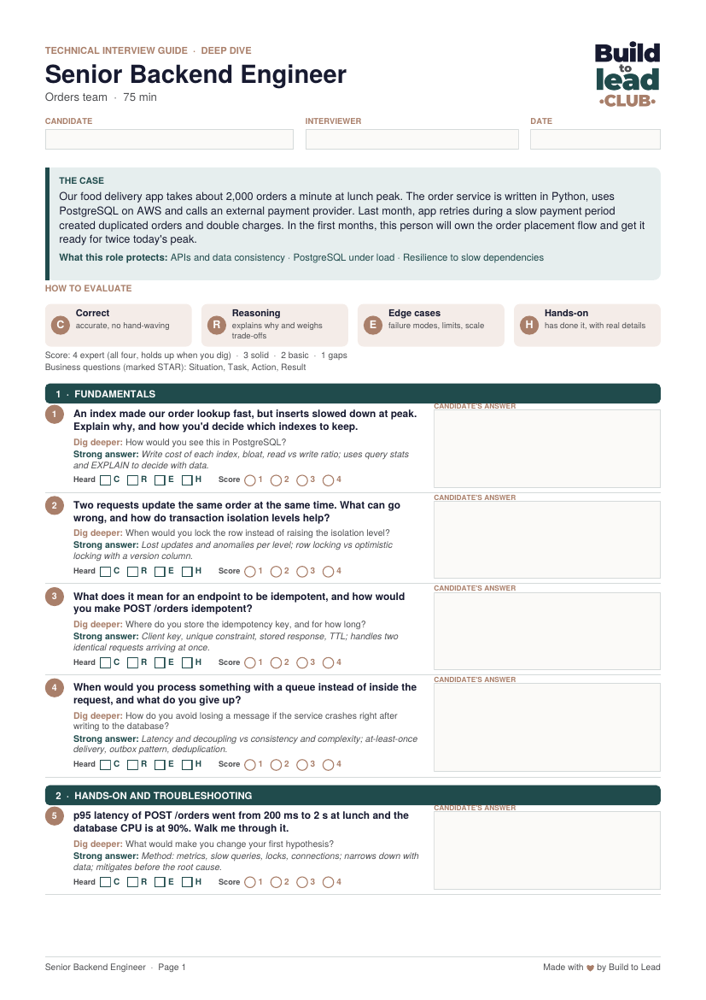
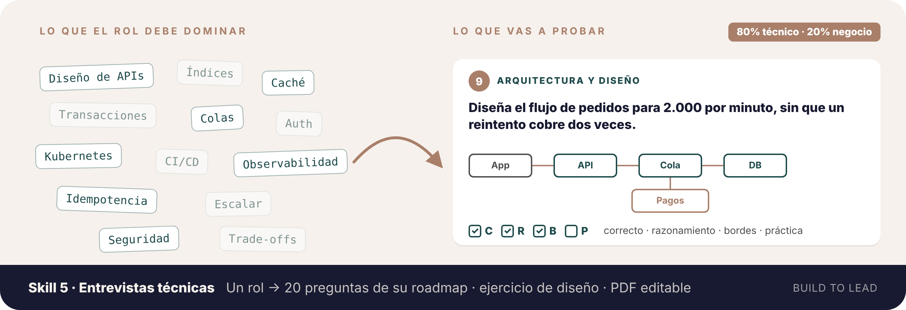
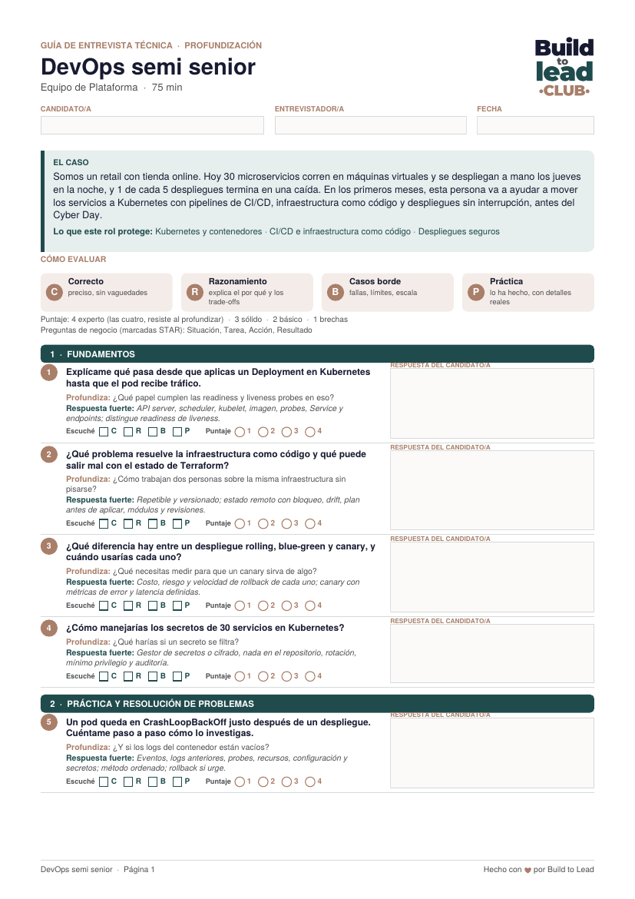

[← All skills · Todos los skills](../README.md)

**[🇺🇸 English 🇬🇧](#english)** · **[🇪🇸 Español 🌎](#espanol)**

---

# 🇺🇸 English 🇬🇧

## 🧪 Skill 5 · Tech interviews

**`tech-interviews`**

*One role to hire in → one technical interview of 20 questions, 80% technical and 20% business, as a fillable PDF.*

Not installed yet? [Install in 1 minute](../README.md#install-en)

A technical interview has to answer one question: **how deep does this person really go?** Most stay at the surface: tool names, definitions, puzzles. This skill prepares an interview that digs, built from what the role works with on its [roadmap.sh](https://roadmap.sh/roadmaps) roadmap, with a short business block so you also know whether the person connects their work to the company.

- 👤 **Built for the role you're hiring:** every role on roadmap.sh, plus SRE and Tech Lead, calibrated to junior, mid, senior or lead, and to your stack.
- 🧩 **One technical use case** with real numbers and constraints, that runs through the interview.
- 🏗️ **An architecture exercise:** the candidate designs a solution for the case (with a large box for your notes on what they draw), and the next questions dig into their own design.
- ⚖️ **80% technical, 20% business:** 16 technical questions and 4 business ones.
- 🔍 **Deep dive on every question:** a follow-up that goes one level down (how it works, what breaks, how you'd measure it).
- ✅ **What a strong answer includes:** one short line per question, so any interviewer scores it the same way.
- 📝 **A fillable PDF of about 3 pages:** answers, letters heard, a 1–4 score per question and a final recommendation.
- 🎨 **Build to Lead design**, in **English or Spanish**, with the option to use your company's logo.

For an interview focused on **business thinking**, use [Skill 4 · Interviews](../tech-to-business-interviews/README.md).

### 🧩 The 5 blocks

| # | Block | Type | What it reveals |
|---|---|---|---|
| 1 | **Fundamentals** | technical | Do they understand how the role's core tools work, not only how to use them? |
| 2 | **Hands-on and troubleshooting** | technical | Can they go from symptom to cause in a real system, with method? |
| 3 | **Architecture and design** | technical | Can they design a solution for the case and defend it? |
| 4 | **Scale, reliability and security** | technical | What breaks first at 10x, how it fails, how it's protected, what it costs? |
| 5 | **Business and teamwork** | business | Do they connect technical decisions to customers, money, risk and time? |

### ⭐ How answers are scored

**Technical questions** use **C · R · E · H**:

| | | Listen for |
|---|---|---|
| **C** | Correct | Accurate, no hand-waving |
| **R** | Reasoning | Explains why and weighs trade-offs |
| **E** | Edge cases | Failure modes, limits, scale |
| **H** | Hands-on | Has done it, with real details |

**Business questions** use **STAR** (Situation, Task, Action, Result).

**4** expert (all four, holds up when you dig) · **3** solid · **2** basic · **1** gaps.

### 👀 Example

**You write:**

> *"I'm the tech lead. I'm hiring a senior backend engineer for our food delivery app. Python and PostgreSQL on AWS. Orders spike at lunch and we've had duplicated orders."*

**You get** a 3-page PDF with the case, the rubric and 20 questions, including the design exercise:

> **9 · Architecture and design** (large box for notes) 
> **Design the order placement flow for 2,000 orders a minute at peak, so a retry from the app or a slow payment provider never creates a duplicate order or a double charge. Draw it end to end.** 
> *Dig deeper:* Walk me through what happens if the payment provider times out after charging. 
> *Strong answer:* Idempotency keys, order state machine, outbox or queue, reconciliation with the provider; covers each failure path. 
> ☐ C ☐ R ☐ E ☐ H · Score ○1 ○2 ○3 ○4

 <a href="../.github/assets/tech-interview-example-en.pdf"><b>Download the fillable PDF example</b></a>

*Fictional example.*

### 🚀 Use it

Start a new chat and **begin with your role** ("I'm a…" / "My role is…"), then the role you're hiring:

> *"**I'm an engineering manager.** Prepare a technical interview for a senior SRE. We run Kubernetes on GCP and the first challenge is reaching our availability target before the holiday peak."*

Add what you know: seniority, stack, the real challenge of the first months, topics to stress or skip. Claude asks once for what's missing and gives you the PDF. Want your own logo? Send it when Claude offers.

You don't need to name the skill. To call it explicitly, type `/` and pick **tech-interviews** (in Claude Code: `/tech-business-skills:tech-interviews`).

> 📝 The PDF is created with code, so **code execution must be on** in Claude. Fill it in any PDF reader: Acrobat, Preview, Chrome or Edge.

 

---

# 🇪🇸 Español 🌎

🇲🇽 🇨🇴 🇦🇷 🇨🇱 🇵🇪 🇻🇪 🇪🇨 🇧🇴 🇺🇾 🇵🇾 🇨🇷 🇵🇦 🇬🇹 🇭🇳 🇸🇻 🇳🇮 🇨🇺 🇩🇴 🇵🇷

## 🧪 Skill 5 · Entrevistas técnicas

**`tech-interviews`**

*Entra el rol que vas a contratar → sale una entrevista técnica de 20 preguntas, 80% técnica y 20% de negocio, en un PDF editable.*

¿Aún no lo tienes? [Instálalo en 1 minuto](../README.md#install-es)

Una entrevista técnica tiene que responder una pregunta: **¿qué tan profundo llega de verdad esta persona?** La mayoría se queda en la superficie: nombres de herramientas, definiciones, acertijos. Este skill prepara una entrevista que profundiza, armada con lo que el rol trabaja según su roadmap en [roadmap.sh](https://roadmap.sh/roadmaps), y con un bloque corto de negocio para saber también si la persona conecta su trabajo con la empresa.

- 👤 **Hecha para el rol que contratas:** todos los roles de roadmap.sh, más SRE y Tech Lead, calibrada a junior, semi senior, senior o lead, y a tu stack.
- 🧩 **Un caso de uso técnico** con números y restricciones reales, que recorre toda la entrevista.
- 🏗️ **Un ejercicio de arquitectura:** la persona diseña una solución para el caso (con un recuadro grande para tus notas sobre lo que dibuja), y las preguntas siguientes profundizan en su propio diseño.
- ⚖️ **80% técnica, 20% negocio:** 16 preguntas técnicas y 4 de negocio.
- 🔍 **Profundización en cada pregunta:** una repregunta que baja un nivel (cómo funciona, qué se rompe, cómo lo medirías).
- ✅ **Qué incluye una respuesta fuerte:** una línea corta por pregunta, para que cualquier entrevistador puntúe igual.
- 📝 **Un PDF editable de unas 3 páginas:** respuestas, letras que escuchaste, puntaje de 1 a 4 por pregunta y una recomendación final.
- 🎨 **Diseño Build to Lead**, en **español o inglés**, con la opción de usar el logo de tu empresa.

Para una entrevista enfocada en **cómo piensa en el negocio**, usa el [Skill 4 · Entrevistas](../tech-to-business-interviews/README.md#espanol).

### 🧩 Los 5 bloques

| # | Bloque | Tipo | Qué revela |
|---|---|---|---|
| 1 | **Fundamentos** | técnica | ¿Entiende cómo funcionan las herramientas centrales del rol, no solo cómo usarlas? |
| 2 | **Práctica y resolución de problemas** | técnica | ¿Llega del síntoma a la causa en un sistema real, con método? |
| 3 | **Arquitectura y diseño** | técnica | ¿Sabe diseñar una solución para el caso y defenderla? |
| 4 | **Escala, confiabilidad y seguridad** | técnica | ¿Qué se rompe primero a 10x, cómo falla, cómo se protege, cuánto cuesta? |
| 5 | **Negocio y trabajo en equipo** | negocio | ¿Conecta las decisiones técnicas con clientes, plata, riesgo y tiempo? |

### ⭐ Cómo se puntúan las respuestas

Las **preguntas técnicas** usan **C · R · B · P**:

| | | Qué escuchar |
|---|---|---|
| **C** | Correcto | Preciso, sin vaguedades |
| **R** | Razonamiento | Explica el por qué y los trade-offs |
| **B** | Casos borde | Fallas, límites, escala |
| **P** | Práctica | Lo ha hecho, con detalles reales |

Las **preguntas de negocio** usan **STAR** (Situación, Tarea, Acción, Resultado).

**4** experto (las cuatro, resiste al profundizar) · **3** sólido · **2** básico · **1** brechas.

### 👀 Ejemplo

**Escribes:**

> *"Soy líder de plataforma. Voy a contratar a una persona DevOps semi senior. Somos un retail con 30 microservicios en máquinas virtuales que se despliegan a mano, y queremos pasar a Kubernetes con CI/CD antes del Cyber Day."*

**Recibes** un PDF de 3 páginas con el caso, la escala y 20 preguntas, incluido el ejercicio de diseño:

> **9 · Arquitectura y diseño** (recuadro grande para notas) 
> **Diseña cómo pasarías los 30 servicios de máquinas virtuales a Kubernetes con CI/CD, sin cortar la tienda. Dibújalo de punta a punta: repositorios, pipeline, ambientes y despliegue.** 
> *Profundiza:* ¿Qué servicio migrarías primero y por qué? 
> *Respuesta fuerte:* Migración gradual por servicio, pipeline estándar, ambientes, IaC, canary o blue-green y rollback probado. 
> ☐ C ☐ R ☐ B ☐ P · Puntaje ○1 ○2 ○3 ○4

 <a href="../.github/assets/tech-interview-example-es.pdf"><b>Descarga el ejemplo en PDF editable</b></a>

*Ejemplo ficticio.*

### 🚀 Úsalo

Abre un chat nuevo y **empieza con tu rol** ("Soy…" / "Mi rol es…"), y después el rol que vas a contratar:

> *"**Soy engineering manager.** Prepárame una entrevista técnica para una SRE senior. Usamos Kubernetes en GCP y el primer desafío es llegar a nuestra meta de disponibilidad antes del peak de fin de año."*

Agrega lo que sepas: seniority, stack, el desafío real de los primeros meses, temas a reforzar o a saltar. Claude pregunta una sola vez por lo que falta y te entrega el PDF. ¿Quieres tu propio logo? Mándalo cuando Claude te lo ofrezca.

No necesitas nombrar el skill. Para llamarlo directo, escribe `/` y elige **tech-interviews** (en Claude Code: `/tech-business-skills:tech-interviews`).

> 📝 El PDF se crea con código, así que **la ejecución de código tiene que estar activada** en Claude. Lo llenas en cualquier lector de PDF: Acrobat, Vista Previa, Chrome o Edge.
