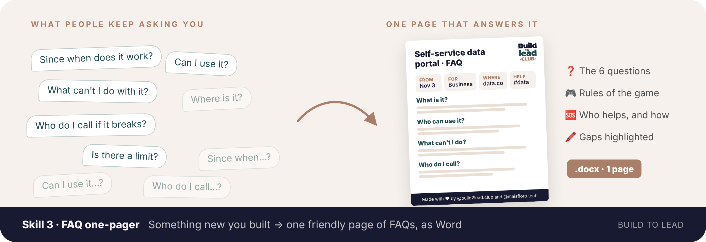
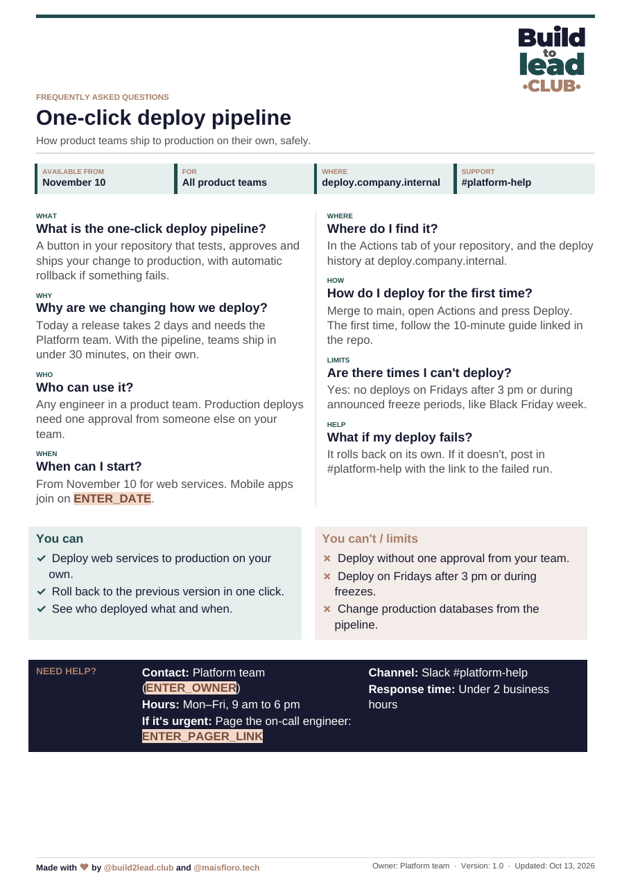
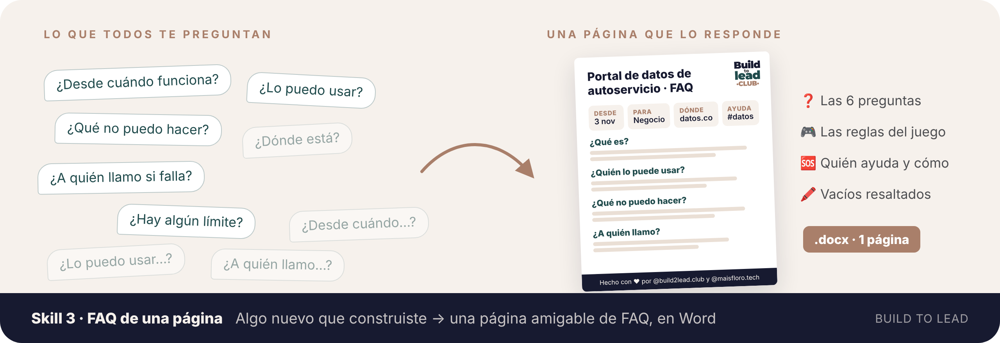
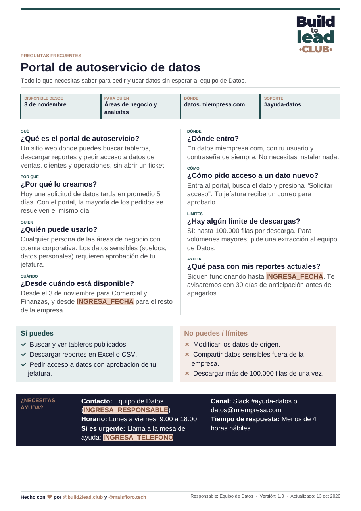

[← All skills · Todos los skills](../README.md)

**[🇺🇸 English 🇬🇧](#english)** · **[🇪🇸 Español 🌎](#espanol)**

---

# 🇺🇸 English 🇬🇧

## 📘 Skill 3 · Tech-to-business FAQ one-pager

**`tech-to-business-faq-one-pager`**

*Something new you built in → one friendly page of FAQs out, as an editable Word document.*

Not installed yet? [Install in 1 minute](../README.md#install-en)

You launched a new tool, platform or process. Now people ask the same things over and over: *since when does it work? what can I do with it? what can't I? who do I call when it breaks?* Technical people rarely write that down. This skill does it for you:

- ❓ **The 6 questions answered:** what it is, why it exists, who it's for, when it's available, where to find it and how to start.
- 🎮 **The rules of the game:** what you **can** do, what you **can't**, and the limits.
- 🆘 **Help, clearly:** who to contact, which channel, what hours, how fast they answer, and what to do if it's urgent.
- 👀 **At a glance:** four boxes with the key facts at the top.
- 📝 **An editable Word document (.docx)** on one page, so your team can adjust it before sharing.
- 🎨 **Build to Lead design:** brand colors, the logo in the corner and *"Made with ♥ by [@build2lead.club](https://www.instagram.com/build2lead.club/) and [@maisfloro.tech](https://www.instagram.com/maisfloro.tech/)"* in the footer, in **English or Spanish**.
- 🗺️ **Attach your architecture diagram** if you have one: Claude uses it to understand the project, keeps internal components (Lambda, queues, secrets…) out of the FAQ, and warns you if the diagram and your message don't match.
- 🔄 **Your logo, if you want:** at the end, Claude offers to swap the Build to Lead logo for your company's (PNG or JPG).
- 🖍️ **Missing data is highlighted** (`ENTER_DATE`, `ENTER_OWNER`), so you see at a glance what to fill in.

### 👀 What you get

 <a href="../.github/assets/faq-example-en.docx"><b>Download the Word example</b></a>

*Fictional examples.*

### 🚀 Use it

Start a new chat and **begin with your role** ("I'm a…" / "My role is…"):

> *"**I'm a platform engineer.** We're launching a one-click deploy pipeline on Nov 10 for all product teams. Make me the FAQ document: …"*

Add whatever you know: dates, who it's for, limits, support channel. Claude asks once for what's missing and gives you the Word file. Want your own logo? Send it when Claude offers, or attach it from the start.

You don't need to name the skill. To call it explicitly, type `/` and pick **tech-to-business-faq-one-pager** (in Claude Code: `/tech-business-skills:tech-to-business-faq-one-pager`).

> 📝 The Word file is created with code, so **code execution must be on** in Claude (it's needed for skills anyway). Without it, you get the same FAQ as text.

 

---

# 🇪🇸 Español 🌎

🇲🇽 🇨🇴 🇦🇷 🇨🇱 🇵🇪 🇻🇪 🇪🇨 🇧🇴 🇺🇾 🇵🇾 🇨🇷 🇵🇦 🇬🇹 🇭🇳 🇸🇻 🇳🇮 🇨🇺 🇩🇴 🇵🇷

## 📘 Skill 3 · FAQ de una página de técnico a negocio

**`tech-to-business-faq-one-pager`**

*Entra algo nuevo que construiste → sale una página amigable de preguntas frecuentes, en un Word editable.*

¿Aún no lo tienes? [Instálalo en 1 minuto](../README.md#install-es)

Lanzaste una herramienta, plataforma o proceso nuevo. Ahora la gente pregunta lo mismo una y otra vez: *¿desde cuándo funciona? ¿qué puedo hacer con esto? ¿qué no? ¿a quién llamo si se cae?* Los técnicos casi nunca lo dejan por escrito. Este skill lo hace por ti:

- ❓ **Las 6 preguntas respondidas:** qué es, para qué existe, para quién es, desde cuándo está disponible, dónde encontrarlo y cómo empezar.
- 🎮 **Las reglas del juego:** lo que **sí** puedes hacer, lo que **no** y los límites.
- 🆘 **La ayuda, clarita:** a quién contactar, por qué canal, en qué horario, en cuánto responden y qué hacer si es urgente.
- 👀 **De un vistazo:** cuatro cajas arriba con los datos clave.
- 📝 **Un Word editable (.docx)** de una página, para que tu equipo lo ajuste antes de compartirlo.
- 🎨 **Diseño Build to Lead:** colores de marca, el logo en la esquina y *"Hecho con ♥ por [@build2lead.club](https://www.instagram.com/build2lead.club/) y [@maisfloro.tech](https://www.instagram.com/maisfloro.tech/)"* en el pie, en **español o inglés**.
- 🗺️ **Adjunta tu diagrama de arquitectura** si lo tienes: Claude lo usa para entender el proyecto, deja fuera del FAQ los componentes internos (Lambda, colas, secretos…) y te avisa si el diagrama y tu mensaje no coinciden.
- 🔄 **Tu logo, si quieres:** al final, Claude te ofrece cambiar el logo de Build to Lead por el de tu empresa (PNG o JPG).
- 🖍️ **Lo que falta queda resaltado** (`INGRESA_FECHA`, `INGRESA_RESPONSABLE`), para que veas de una qué completar.

### 👀 Lo que recibes

 <a href="../.github/assets/faq-example-es.docx"><b>Descarga el ejemplo en Word</b></a>

*Ejemplos ficticios.*

### 🚀 Úsalo

Abre un chat nuevo y **empieza con tu rol** ("Soy…" / "Mi rol es…"):

> *"**Soy ingeniera de datos.** Vamos a lanzar un portal de autoservicio de datos el 3 de noviembre. Hazme el documento de preguntas frecuentes: …"*

Agrega lo que sepas: fechas, para quién es, límites, canal de soporte. Claude pregunta una sola vez por lo que falta y te entrega el Word. ¿Quieres tu propio logo? Mándalo cuando Claude te lo ofrezca, o adjúntalo desde el principio.

No necesitas nombrar el skill. Para llamarlo directo, escribe `/` y elige **tech-to-business-faq-one-pager** (en Claude Code: `/tech-business-skills:tech-to-business-faq-one-pager`).

> 📝 El Word se crea con código, así que **la ejecución de código tiene que estar activada** en Claude (igual se necesita para los skills). Sin ella, recibes el mismo FAQ como texto.
