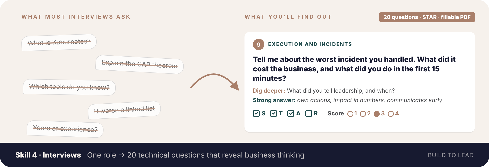
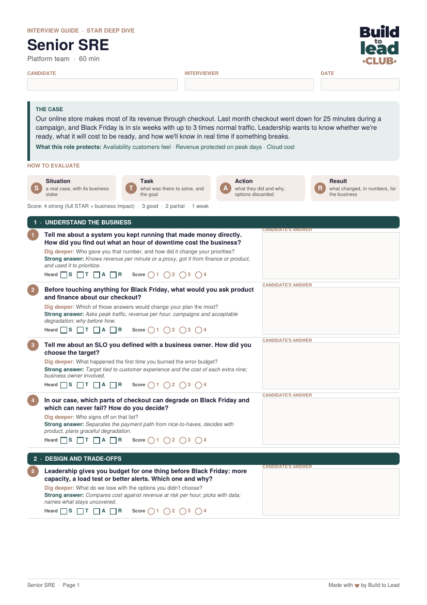
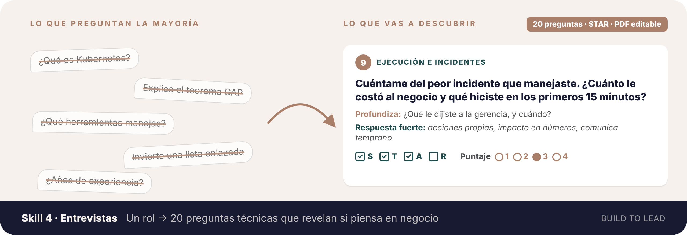
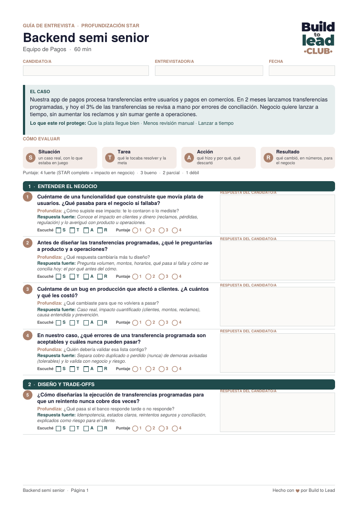

[← All skills · Todos los skills](../README.md)

**[🇺🇸 English 🇬🇧](#english)** · **[🇪🇸 Español 🌎](#espanol)**

---

# 🇺🇸 English 🇬🇧

## 🎤 Skill 4 · Tech-to-business interviews

**`tech-to-business-interviews`**

*One role to hire in → one interview of 20 technical questions that reveal business thinking, as a fillable PDF.*

Not installed yet? [Install in 1 minute](../README.md#install-en)

Interviewing someone new isn't simple: it takes preparation, and most technical interviews only check whether the candidate knows the tools. This skill prepares the interview that tells you something harder to find out: **whether the person connects technical work to customers, money, risk and time.**

- 👤 **Built for the role you're hiring:** every role on [roadmap.sh](https://roadmap.sh/roadmaps), plus SRE and Tech Lead, calibrated to junior, mid, senior or lead.
- 🧩 **One use case for the role:** a realistic situation with a business stake, taken from your context, that runs through the whole interview.
- ❓ **20 technical questions in 5 blocks:** every one asks for the business side, half from real experience, half applied to the case.
- 🔍 **STAR deep dive:** a follow-up for each question, aimed at the letter people usually skip.
- ✅ **What a strong answer includes:** one short line per question, so any interviewer scores it the same way.
- 📝 **A fillable PDF of about 3 pages:** type the candidate's answers, tick the STAR letters you heard, score each question 1–4 and close with a recommendation.
- 🎨 **Build to Lead design**, in **English or Spanish**, with the option to use your company's logo.
- ⚖️ **Fair by design:** questions only about the job, the same guide and scale for every candidate.

### 🧩 The 5 blocks

| # | Block | What it reveals |
|---|---|---|
| 1 | **Understand the business** | Do they ask *why* before *how*? Do they know what breaks, and for whom? |
| 2 | **Design and trade-offs** | Do they choose by cost, risk and customer impact, not only by technical taste? |
| 3 | **Execution and incidents** | What did they actually do under pressure, and how did they protect customers? |
| 4 | **Impact and metrics** | Can they climb from what they did to what changed and why it matters? |
| 5 | **Stakeholders and communication** | Can they explain it to leadership, ask for budget and say no? |

### ⭐ How answers are scored

| | STAR | Listen for |
|---|---|---|
| **S** | Situation | A real case, with its business stake |
| **T** | Task | What was theirs to solve, and the goal |
| **A** | Action | What they did and why, options discarded |
| **R** | Result | What changed, in numbers, for the business |

**4** strong (full STAR and business impact) · **3** good · **2** partial · **1** weak.

### 👀 Example

**You write:**

> *"I'm the head of engineering. I need to interview a senior SRE for our e-commerce. Black Friday is in six weeks and last month checkout went down 25 minutes during a campaign."*

**You get** a 3-page PDF with the case, the STAR scale and 20 questions like this one:

> **5 · Design and trade-offs** 
> **Leadership gives you budget for one thing before Black Friday: more capacity, a load test or better alerts. Which one and why?** 
> *Dig deeper:* What do we lose with the options you didn't choose? 
> *Strong answer:* Compares cost against revenue at risk per hour; picks with data; names what stays uncovered. 
> ☐ S ☐ T ☐ A ☐ R · Score ○1 ○2 ○3 ○4

 <a href="../.github/assets/interview-example-en.pdf"><b>Download the fillable PDF example</b></a>

*Fictional example.*

### 🚀 Use it

Start a new chat and **begin with your role** ("I'm a…" / "My role is…"), then the role you're hiring:

> *"**I'm an engineering manager.** Prepare the interview for a mid-level data engineer. We're a retailer moving our sales reports to a new data platform this quarter."*

Add what you know: seniority, industry, the real challenge of the first months, what you care about most. Claude asks once for what's missing and gives you the PDF. Want your own logo? Send it when Claude offers.

You don't need to name the skill. To call it explicitly, type `/` and pick **tech-to-business-interviews** (in Claude Code: `/tech-business-skills:tech-to-business-interviews`).

> 📝 The PDF is created with code, so **code execution must be on** in Claude. Fill it in any PDF reader: Acrobat, Preview, Chrome or Edge.

 

---

# 🇪🇸 Español 🌎

🇲🇽 🇨🇴 🇦🇷 🇨🇱 🇵🇪 🇻🇪 🇪🇨 🇧🇴 🇺🇾 🇵🇾 🇨🇷 🇵🇦 🇬🇹 🇭🇳 🇸🇻 🇳🇮 🇨🇺 🇩🇴 🇵🇷

## 🎤 Skill 4 · Entrevistas de técnico a negocio

**`tech-to-business-interviews`**

*Entra el rol que vas a contratar → sale una entrevista de 20 preguntas técnicas que revelan si la persona piensa en negocio, en un PDF editable.*

¿Aún no lo tienes? [Instálalo en 1 minuto](../README.md#install-es)

Entrevistar a alguien nuevo no es simple: requiere preparación, y la mayoría de las entrevistas técnicas solo revisan si la persona conoce las herramientas. Este skill prepara la entrevista que te dice algo más difícil de descubrir: **si la persona conecta el trabajo técnico con clientes, plata, riesgo y tiempo.**

- 👤 **Hecha para el rol que contratas:** todos los roles de [roadmap.sh](https://roadmap.sh/roadmaps), más SRE y Tech Lead, calibrada a junior, semi senior, senior o lead.
- 🧩 **Un caso de uso para el rol:** una situación realista con algo en juego para el negocio, sacada de tu contexto, que recorre toda la entrevista.
- ❓ **20 preguntas técnicas en 5 bloques:** todas piden el lado de negocio; la mitad sobre experiencia real y la mitad aplicadas al caso.
- 🔍 **Profundización STAR:** una repregunta por pregunta, apuntada a la letra que la gente suele saltarse.
- ✅ **Qué incluye una respuesta fuerte:** una línea corta por pregunta, para que cualquier entrevistador puntúe igual.
- 📝 **Un PDF editable de unas 3 páginas:** escribe las respuestas del candidato o candidata, marca las letras STAR que escuchaste, puntúa cada pregunta de 1 a 4 y cierra con una recomendación.
- 🎨 **Diseño Build to Lead**, en **español o inglés**, con la opción de usar el logo de tu empresa.
- ⚖️ **Justa desde el diseño:** solo preguntas sobre el trabajo, la misma guía y la misma escala para todas las personas candidatas.

### 🧩 Los 5 bloques

| # | Bloque | Qué revela |
|---|---|---|
| 1 | **Entender el negocio** | ¿Pregunta el *por qué* antes del *cómo*? ¿Sabe qué se rompe y para quién? |
| 2 | **Diseño y trade-offs** | ¿Elige por costo, riesgo e impacto en clientes, no solo por gusto técnico? |
| 3 | **Ejecución e incidentes** | ¿Qué hizo de verdad bajo presión y cómo protegió a los clientes? |
| 4 | **Impacto y métricas** | ¿Sube de lo que hizo a lo que cambió y por qué importa? |
| 5 | **Stakeholders y comunicación** | ¿Sabe explicarlo a la gerencia, pedir presupuesto y decir que no? |

### ⭐ Cómo se puntúan las respuestas

| | STAR | Qué escuchar |
|---|---|---|
| **S** | Situación | Un caso real, con lo que estaba en juego para el negocio |
| **T** | Tarea | Qué le tocaba resolver y la meta |
| **A** | Acción | Qué hizo y por qué, qué descartó |
| **R** | Resultado | Qué cambió, en números, para el negocio |

**4** fuerte (STAR completo e impacto en negocio) · **3** bueno · **2** parcial · **1** débil.

### 👀 Ejemplo

**Escribes:**

> *"Soy líder de ingeniería. Necesito entrevistar a un desarrollador backend semi senior para nuestra app de pagos. En 2 meses lanzamos transferencias programadas y hoy el 3% de las transferencias se revisa a mano."*

**Recibes** un PDF de 3 páginas con el caso, la escala STAR y 20 preguntas como esta:

> **5 · Diseño y trade-offs** 
> **¿Cómo diseñarías la ejecución de transferencias programadas para que un reintento nunca cobre dos veces?** 
> *Profundiza:* ¿Qué pasa si el banco responde tarde o no responde? 
> *Respuesta fuerte:* Idempotencia, estados claros, reintentos seguros y conciliación, explicados como riesgo para el cliente. 
> ☐ S ☐ T ☐ A ☐ R · Puntaje ○1 ○2 ○3 ○4

 <a href="../.github/assets/interview-example-es.pdf"><b>Descarga el ejemplo en PDF editable</b></a>

*Ejemplo ficticio.*

### 🚀 Úsalo

Abre un chat nuevo y **empieza con tu rol** ("Soy…" / "Mi rol es…"), y después el rol que vas a contratar:

> *"**Soy engineering manager.** Prepárame la entrevista para una ingeniera de datos semi senior. Somos un retail y este trimestre movemos los reportes de ventas a una nueva plataforma de datos."*

Agrega lo que sepas: seniority, industria, el desafío real de los primeros meses, lo que más te importa. Claude pregunta una sola vez por lo que falta y te entrega el PDF. ¿Quieres tu propio logo? Mándalo cuando Claude te lo ofrezca.

No necesitas nombrar el skill. Para llamarlo directo, escribe `/` y elige **tech-to-business-interviews** (en Claude Code: `/tech-business-skills:tech-to-business-interviews`).

> 📝 El PDF se crea con código, así que **la ejecución de código tiene que estar activada** en Claude. Lo llenas en cualquier lector de PDF: Acrobat, Vista Previa, Chrome o Edge.
