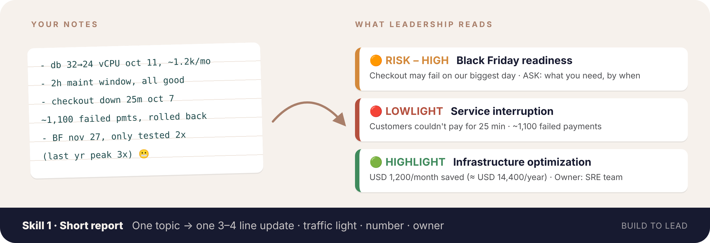
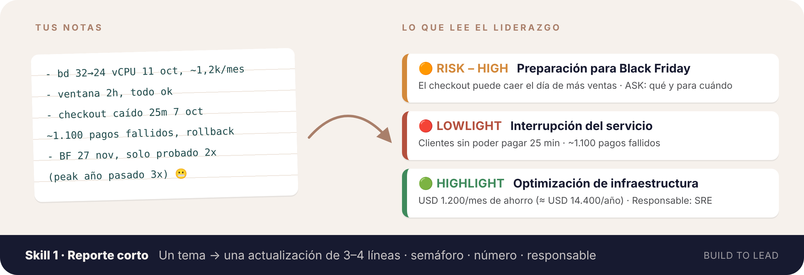

[← All skills · Todos los skills](../README.md)

<div align="center">

**[🇺🇸 English 🇬🇧](#english)** · **[🇪🇸 Español 🌎](#espanol)**

</div>

---

<a id="english"></a>

<div align="center">

# 🇺🇸 English 🇬🇧



## 📄 Skill 1 · Tech-to-business short report

**`tech-to-business-short-report`**

*One technical topic in → one 3–4 line business update out.*

Not installed yet? [Install in 1 minute](../README.md#install-en)

</div>

You tell it your **role** and what happened (notes, tickets, a few numbers). It asks **once**, only if something basic is missing, and gives you back:

- 🎯 **One topic, one item.** One thing, done well. No splitting a single change into five bullets.
- ✂️ **3–4 lines.** No essays, no one-pagers.
- 🚦 **A traffic light** the business reads in a second: 🟢 good, 🟠 watch out, 🔴 bad.
- ❓ **The 6 questions answered:** what, why, when, where, who and how.
- 🗣️ **Business words:** "Infrastructure optimization, 25% smaller", not "DB downsized to 24 vCPU".
- 🔮 **Risks anticipated:** if your notes hint at something that could go wrong, it flags it before it becomes a fire.
- 🙋 **Every risk ends with an ask:** what you need, from whom, by when.
- 👤 **Every item has an owner:** the team or person the business can go to with questions.

### 🚦 The three labels

Every report item gets exactly one, picked by its **effect on the business**, not by how technical it was.

| | Label | Meaning | Examples |
|---|---|---|---|
| 🟢 | **[HIGHLIGHT]** | Something **good for the business** already happened | Money saved or earned, happier customers, time saved, risk reduced, incidents avoided |
| 🟠 | **[RISK – LOW / MEDIUM / HIGH]** | Something **could** hurt the business, or an opportunity could be lost | A peak the system may not hold, a deadline at risk, rising costs, someone key leaving |
| 🔴 | **[LOWLIGHT]** | Something **bad for the business** already happened | Outage customers noticed, lost revenue, security incident, missed commitment |

Need budget, people or a decision? Write the risk of **not** getting it, then the **ASK**. If it isn't good, bad or a risk for the business, it doesn't go in. No "FYI" padding.

### ❓ The 6 questions every item answers

| | Question | In the first example below |
|---|---|---|
| 📌 | **What?** | Optimized the infrastructure, USD 1,200/month saved |
| 🎯 | **Why?** | To reduce operating costs |
| 📅 | **When?** | On Oct 11 |
| 📍 | **Where?** | Our main database |
| 👥 | **Who?** | The SRE team, named as **Owner** so the business knows who to ask |
| 🛠️ | **How?** | Planned 2-hour maintenance window, monitoring after the change |

### 👀 Example: one topic → one item

**You write:**

> *"I'm an SRE. Downsized the main database from 32 to 24 vCPU on Oct 11, saves about USD 1,200/month. The database costs ~USD 10,000/month. 2-hour maintenance window."*

**You get:**

> 🟢 **[HIGHLIGHT] Infrastructure optimization:** On Oct 11, the SRE team optimized the infrastructure of our main database to reduce operating costs, reducing its size by 25% and generating savings of USD 1,200/month (≈ USD 14,400/year, 12% of its current cost). The change was made in a planned 2-hour maintenance window, and we're monitoring closely to ensure availability for our customers.<br>
> **Owner:** SRE team

Saving money is good for the business, so it's a 🟢 HIGHLIGHT. The title is in business words, "32 → 24 vCPU" becomes "25% smaller", and it closes by reassuring the reader about customers.

### 👀 Example: several topics → several items

**You write:**

> *"I'm an SRE. Checkout down 25 min Tuesday Oct 7, ~1,100 failed payments, DB connections maxed in a release; we rolled back and added a connection check to releases. Black Friday is Nov 27, never load-tested above 2x, last year's peak was 3x."*

**You get:**

> **Overall: 🟠 RISK – HIGH**
>
> 🟠 **[RISK – HIGH] Black Friday readiness:** on Black Friday (Nov 27), our checkout could slow down or fail for customers on the highest-revenue day of the year. Last year's peak was 3 times normal traffic and the SRE team has only tested up to 2 times.<br>
> **ASK:** ENTER_WHAT_YOU_NEED_AND_BY_WHEN.<br>
> **Owner:** SRE team
>
> 🔴 **[LOWLIGHT] Service interruption:** On Oct 7, customers couldn't pay in checkout for 25 minutes (~1,100 failed payments). An update overloaded the database; the SRE team reverted it and now checks every update for this before release.<br>
> **Owner:** SRE team

The Black Friday comment was a side note in the input; the skill turned it into the first thing leadership reads. You didn't say what you need, so instead of inventing an ask it leaves **ENTER_WHAT_YOU_NEED_AND_BY_WHEN** for you to replace.

### 👀 More examples by role

<details>
<summary><b>👩‍💻 Backend developer → 🟢 HIGHLIGHT</b></summary>

**You write:**

> *"I'm a backend developer. On Oct 9 we released the new search filters in the web store, together with Product and Support. Search-related support tickets dropped from 120 to 45 per month."*

**You get:**

```
🟢 [HIGHLIGHT] Better search for customers: On Oct 9, the backend team released new search filters in our web store, together with the Product and Support teams. Since then, support tickets about search dropped from 120 to 45 per month (−63%), so customers find products with less help.
Owner: Backend team (ENTER_OWNER)
```

</details>

<details>
<summary><b>🛡️ Cybersecurity → 🟠 RISK – HIGH</b></summary>

**You write:**

> *"My role is security analyst. 3 critical vulnerabilities on the customer portal have been open for 30 days; our policy is 15. The patch needs a 1-hour downtime that Product hasn't approved yet. SOC 2 audit is on Nov 20."*

**You get:**

```
🟠 [RISK – HIGH] Customer portal security: three critical security gaps on our customer portal have been open for 30 days, twice our 15-day policy, and could be flagged in the SOC 2 external security audit on Nov 20. Fixing them needs a 1-hour planned downtime of the portal.
ASK: Product team to approve the 1-hour maintenance window by ENTER_DATE.
Owner: Security team (ENTER_OWNER)
```

</details>

<details>
<summary><b>📊 Data engineer → 🔴 LOWLIGHT</b></summary>

**You write:**

> *"I'm a data engineer. On Oct 6 the daily sales pipeline failed and the sales dashboard was 2 days out of date; the commercial team built the weekly forecast with old data. A source system changed its schema without notice. We added schema checks and alerts."*

**You get:**

```
🔴 [LOWLIGHT] Data availability for decisions: On Oct 6, our daily sales data stopped updating, so the sales dashboard was 2 days out of date and the commercial team built the weekly forecast with old data. A source system changed its data format without notice; the data engineering team added automatic format checks and alerts.
Owner: Data Engineering team (ENTER_OWNER)
```

</details>

<details>
<summary><b>📊 BI analyst → 🟢 HIGHLIGHT</b></summary>

**You write:**

> *"I'm a BI analyst. On Oct 2 we published the automated monthly close dashboard for Finance. They used to build the report by hand in 5 days; for the September close it took 1 day."*

**You get:**

```
🟢 [HIGHLIGHT] Faster monthly close for Finance: On Oct 2, the BI team published an automated monthly close dashboard for Finance, who used to build the report by hand. In the September close, the report went from 5 days to 1 (−80%), freeing 4 days of the Finance team's work every month.
Owner: BI team (ENTER_OWNER)
```

</details>

### 🪜 From "what I did" to "why it matters"

| | 🔧 Output<br>*what I did* | 📈 Outcome<br>*what changed* | 💼 Business impact<br>*why anyone cares* |
|---|---|---|---|
| **👩‍💻 Developer** | Shipped search filters, fixed 14 bugs | 38% of searches use filters; search tickets 120 → 45/month | ~75 fewer tickets/month ≈ half a support person freed |
| **🎤 Developer Relations** | Gave 12 talks and 4 workshops | 340 sign-ups from the target audience, 60 active accounts | New active users at a fraction of paid acquisition cost |
| **🛡️ Cyber Security** | Closed 300 vulnerabilities | Critical exposure window down from 45 to 9 days | Audit passed with zero critical findings; enterprise deal unblocked |
| **⚙️ SRE / DevOps** | Rightsized cloud resources, added alerting | Monthly bill USD 41k → 34.5k; payment errors detected in 4 min (was 20) | ≈ USD 78k/year saved; issues caught before customers notice |
| **📊 Data Engineer** | Migrated 20 pipelines | Data freshness from 24h to 1h; zero failed loads this month | Sales sees yesterday's numbers this morning, not tomorrow |

*All figures are fictional examples.*

The skill knows **31+ roles** (based on the role-based roadmaps of [roadmap.sh](https://roadmap.sh/roadmaps), plus SRE and Tech Lead), so it knows which numbers matter for yours. A useful question for any role: **what breaks, and for whom, if you stop doing your job for a month?** That's usually your business impact.

### 🚀 Use it

Start a new chat and **begin with your role** ("I'm a…" / "My role is…"):

> *"**I'm a backend developer.** Turn this into an update for my director: …"*

Paste whatever you have: notes, ticket titles, numbers. **Messy is fine.** It works for a single change, an incident, a week or a project.

You don't need to name the skill. To call it explicitly, type `/` and pick **tech-to-business-short-report** (in Claude Code: `/tech-business-skills:tech-to-business-short-report`).

<br>

---

<a id="espanol"></a>

<div align="center">

# 🇪🇸 Español 🌎

🇲🇽 🇨🇴 🇦🇷 🇨🇱 🇵🇪 🇻🇪 🇪🇨 🇧🇴 🇺🇾 🇵🇾 🇨🇷 🇵🇦 🇬🇹 🇭🇳 🇸🇻 🇳🇮 🇨🇺 🇩🇴 🇵🇷



## 📄 Skill 1 · Reporte corto de técnico a negocio

**`tech-to-business-short-report`**

*Entra un tema técnico → sale una actualización de negocio de 3–4 líneas.*

¿Aún no lo tienes? [Instálalo en 1 minuto](../README.md#install-es)

</div>

Le dices tu **rol** y qué pasó (notas, tickets, algunos números). Pregunta **una sola vez**, y solo si falta algo básico, y te devuelve:

- 🎯 **Un tema, un ítem.** Una cosa bien hecha. Nada de partir un solo cambio en cinco bullets.
- ✂️ **3–4 líneas.** Sin ensayos ni documentos de una página.
- 🚦 **Un semáforo** que el negocio lee en un segundo: 🟢 bien, 🟠 ojo, 🔴 mal.
- ❓ **Las 6 preguntas respondidas:** qué, por qué, cuándo, dónde, quién y cómo.
- 🗣️ **Palabras de negocio:** "Optimización de infraestructura, 25% más pequeña", no "BD bajada a 24 vCPU".
- 🔮 **Riesgos anticipados:** si tus notas dejan ver algo que puede salir mal, lo levanta antes de que se vuelva un incendio.
- 🙋 **Todo riesgo termina con un pedido (ASK):** qué necesitas, de quién y para cuándo.
- 👤 **Todo ítem tiene un responsable:** el equipo o la persona a quien el negocio le puede preguntar.

### 🚦 Las tres etiquetas

Cada ítem del reporte lleva exactamente una, elegida por su **efecto en el negocio**, no por qué tan técnico fue.

| | Etiqueta | Significa | Ejemplos |
|---|---|---|---|
| 🟢 | **[HIGHLIGHT]** | Ya pasó algo **bueno para el negocio** | Plata ahorrada o ganada, clientes más contentos, tiempo ahorrado, riesgo reducido, incidentes evitados |
| 🟠 | **[RISK – LOW / MEDIUM / HIGH]** | Algo **podría** afectar al negocio, o se podría perder una oportunidad | Un peak que el sistema quizás no aguante, una fecha en riesgo, costos que suben, alguien clave que se va |
| 🔴 | **[LOWLIGHT]** | Ya pasó algo **malo para el negocio** | Caída que los clientes notaron, ingresos perdidos, incidente de seguridad, compromiso incumplido |

¿Necesitas presupuesto, gente o una decisión? Escribe el riesgo de **no** tenerlo y después el **ASK**. Si no es bueno, malo ni un riesgo para el negocio, no va. Nada de relleno "para tu información".

Las etiquetas quedan en inglés por defecto porque son vocabulario común entre equipos; si las quieres traducidas, pídelo.

### ❓ Las 6 preguntas que responde cada ítem

| | Pregunta | En el primer ejemplo de abajo |
|---|---|---|
| 📌 | **¿Qué?** | Optimizó la infraestructura, USD 1.200/mes de ahorro |
| 🎯 | **¿Por qué?** | Para reducir costos operativos |
| 📅 | **¿Cuándo?** | El 11 de octubre |
| 📍 | **¿Dónde?** | Nuestra base de datos principal |
| 👥 | **¿Quién?** | El equipo SRE, nombrado como **Responsable** para que el negocio sepa a quién preguntar |
| 🛠️ | **¿Cómo?** | Ventana de mantenimiento planificada de 2 horas, con monitoreo después del cambio |

### 👀 Ejemplo: un tema → un ítem

**Escribes:**

> *"Soy SRE. Bajamos la base de datos principal de 32 a 24 vCPU el 11 de octubre, ahorra unos USD 1.200/mes. La base cuesta ~USD 10.000/mes. Ventana de mantenimiento de 2 horas."*

**Recibes:**

> 🟢 **[HIGHLIGHT] Optimización de infraestructura:** El 11 de octubre, el equipo SRE optimizó la infraestructura de nuestra base de datos principal para reducir costos operativos, bajando su tamaño en 25% y generando un ahorro de USD 1.200/mes (≈ USD 14.400/año, 12% de su costo actual). El cambio se hizo en una ventana de mantenimiento planificada de 2 horas y estamos monitoreando de cerca para asegurar la disponibilidad para nuestros clientes.<br>
> **Responsable:** Equipo SRE

Ahorrar plata es bueno para el negocio, así que es un 🟢 HIGHLIGHT. El título está en palabras de negocio, "32 → 24 vCPU" pasa a "25% más pequeña", y cierra tranquilizando al lector sobre los clientes.

### 👀 Ejemplo: varios temas → varios ítems

**Escribes:**

> *"Soy SRE. Checkout caído 25 min el martes 7 de octubre, ~1.100 pagos fallidos, las conexiones a la BD se saturaron en un release; hicimos rollback y agregamos un chequeo de conexiones a los releases. Black Friday es el 27 de noviembre, nunca hicimos pruebas de carga sobre 2x y el peak del año pasado fue 3x."*

**Recibes:**

> **General: 🟠 RISK – HIGH**
>
> 🟠 **[RISK – HIGH] Preparación para Black Friday:** en Black Friday (27 de noviembre), nuestro checkout podría ponerse lento o fallar para los clientes en el día de más ingresos del año. El peak del año pasado fue 3 veces el tráfico normal y el equipo SRE solo ha probado hasta 2 veces.<br>
> **ASK:** INGRESA_QUE_NECESITAS_Y_PARA_CUANDO.<br>
> **Responsable:** Equipo SRE
>
> 🔴 **[LOWLIGHT] Interrupción del servicio:** El 7 de octubre, los clientes no pudieron pagar en el checkout durante 25 minutos (~1.100 pagos fallidos). Una actualización sobrecargó la base de datos; el equipo SRE la revirtió y ahora revisa esto en cada actualización antes de publicarla.<br>
> **Responsable:** Equipo SRE

Lo de Black Friday era un comentario al pasar; el skill lo convirtió en lo primero que lee el liderazgo. No dijiste qué necesitas, así que en vez de inventar el pedido deja **INGRESA_QUE_NECESITAS_Y_PARA_CUANDO** para que lo reemplaces.

### 👀 Más ejemplos por rol

<details>
<summary><b>👩‍💻 Desarrolladora backend → 🟢 HIGHLIGHT</b></summary>

**Escribes:**

> *"Soy desarrolladora backend. El 9 de octubre lanzamos los nuevos filtros de búsqueda en la tienda web, junto a Producto y Soporte. Los tickets de soporte sobre búsqueda bajaron de 120 a 45 al mes."*

**Recibes:**

```
🟢 [HIGHLIGHT] Mejor búsqueda para los clientes: El 9 de octubre, el equipo backend lanzó nuevos filtros de búsqueda en nuestra tienda web, junto a los equipos de Producto y Soporte. Desde entonces, los tickets de soporte sobre búsqueda bajaron de 120 a 45 al mes (−63%), así que los clientes encuentran productos con menos ayuda.
Responsable: Equipo backend (INGRESA_RESPONSABLE)
```

</details>

<details>
<summary><b>🛡️ Ciberseguridad → 🟠 RISK – HIGH</b></summary>

**Escribes:**

> *"Mi rol es analista de seguridad. Hay 3 vulnerabilidades críticas en el portal de clientes abiertas hace 30 días; nuestra política es 15. El parche necesita 1 hora sin servicio que Producto todavía no aprueba. La auditoría SOC 2 es el 20 de noviembre."*

**Recibes:**

```
🟠 [RISK – HIGH] Seguridad del portal de clientes: tres brechas de seguridad críticas en nuestro portal de clientes llevan 30 días abiertas, el doble de nuestra política de 15 días, y podrían salir en la auditoría externa de seguridad SOC 2 del 20 de noviembre. Corregirlas requiere 1 hora de mantenimiento planificado del portal.
ASK: que el equipo de Producto apruebe la ventana de mantenimiento de 1 hora antes del INGRESA_FECHA.
Responsable: Equipo de Seguridad (INGRESA_RESPONSABLE)
```

</details>

<details>
<summary><b>📊 Ingeniería de datos → 🔴 LOWLIGHT</b></summary>

**Escribes:**

> *"Soy ingeniera de datos. El 6 de octubre falló el pipeline diario de ventas y el tablero de ventas quedó 2 días desactualizado; el equipo comercial armó el forecast semanal con datos viejos. Un sistema de origen cambió su esquema sin avisar. Agregamos validaciones de esquema y alertas."*

**Recibes:**

```
🔴 [LOWLIGHT] Disponibilidad de datos para decidir: El 6 de octubre, nuestros datos diarios de ventas dejaron de actualizarse, así que el tablero de ventas quedó 2 días desactualizado y el equipo comercial armó el forecast semanal con datos viejos. Un sistema de origen cambió su formato de datos sin avisar; el equipo de ingeniería de datos agregó validaciones automáticas de formato y alertas.
Responsable: Equipo de Ingeniería de Datos (INGRESA_RESPONSABLE)
```

</details>

<details>
<summary><b>📊 Analista de BI → 🟢 HIGHLIGHT</b></summary>

**Escribes:**

> *"Soy analista de BI. El 2 de octubre publicamos el tablero automático de cierre mensual para Finanzas. Antes armaban el reporte a mano en 5 días, en el cierre de septiembre les tomó 1 día."*

**Recibes:**

```
🟢 [HIGHLIGHT] Cierre mensual más rápido para Finanzas: El 2 de octubre, el equipo de BI publicó un tablero automático de cierre mensual para Finanzas, que antes armaba el reporte a mano. En el cierre de septiembre, el reporte pasó de 5 días a 1 (−80%), liberando 4 días de trabajo del equipo de Finanzas cada mes.
Responsable: Equipo de BI (INGRESA_RESPONSABLE)
```

</details>

### 🪜 De "lo que hice" a "por qué importa"

| | 🔧 Entregable<br>*lo que hice* | 📈 Resultado<br>*lo que cambió* | 💼 Impacto en el negocio<br>*por qué le importa a alguien* |
|---|---|---|---|
| **👩‍💻 Desarrollo** | Lancé filtros de búsqueda, corregí 14 bugs | 38% de las búsquedas usan filtros; tickets de búsqueda 120 → 45/mes | ~75 tickets menos al mes ≈ media persona de soporte liberada |
| **🎤 Developer Relations** | Di 12 charlas y 4 talleres | 340 registros de la audiencia objetivo, 60 cuentas activas | Usuarios activos nuevos a una fracción del costo de adquisición pagada |
| **🛡️ Ciberseguridad** | Cerré 300 vulnerabilidades | Ventana de exposición crítica de 45 a 9 días | Auditoría aprobada sin hallazgos críticos; venta enterprise desbloqueada |
| **⚙️ SRE / DevOps** | Ajusté recursos cloud, agregué alertas | Factura mensual USD 41k → 34,5k; errores de pago detectados en 4 min (antes 20) | ≈ USD 78k/año de ahorro; problemas detectados antes que los clientes |
| **📊 Ingeniería de datos** | Migré 20 pipelines | Datos frescos en 1 h en vez de 24 h; cero cargas fallidas este mes | Ventas ve los números de ayer esta mañana, no mañana |

*Todas las cifras son ejemplos ficticios.*

El skill conoce **más de 31 roles** (basados en los roadmaps por rol de [roadmap.sh](https://roadmap.sh/roadmaps), más SRE y Tech Lead), así que sabe qué números importan para el tuyo. Una pregunta útil para cualquier rol: **¿qué se rompe, y para quién, si dejas de hacer tu trabajo durante un mes?** Ese suele ser tu impacto en el negocio.

### 🚀 Úsalo

Abre un chat nuevo y **empieza con tu rol** ("Soy…" / "Mi rol es…"):

> *"**Soy desarrolladora backend.** Conviértelo en una actualización para mi directora: …"*

Pega lo que tengas: notas, títulos de tickets, números. **Desordenado está bien.** Sirve para un cambio, un incidente, una semana o un proyecto. También puedes mezclar idiomas: *"háblame en español pero el reporte en inglés para mi jefe global"*.

No necesitas nombrar el skill. Para llamarlo directo, escribe `/` y elige **tech-to-business-short-report** (en Claude Code: `/tech-business-skills:tech-to-business-short-report`).
