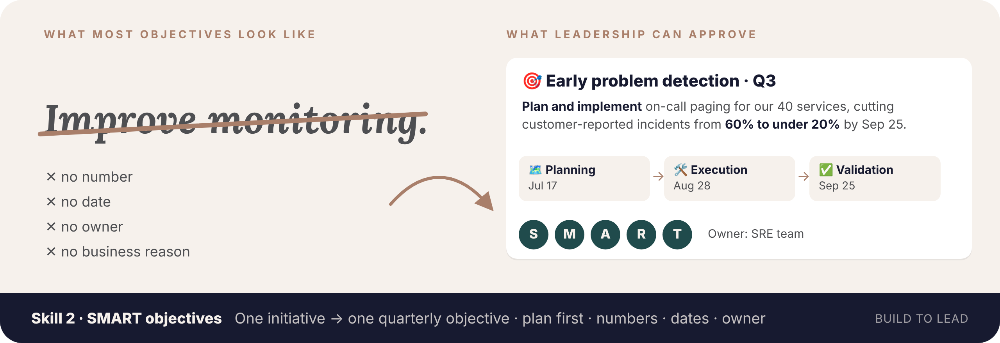
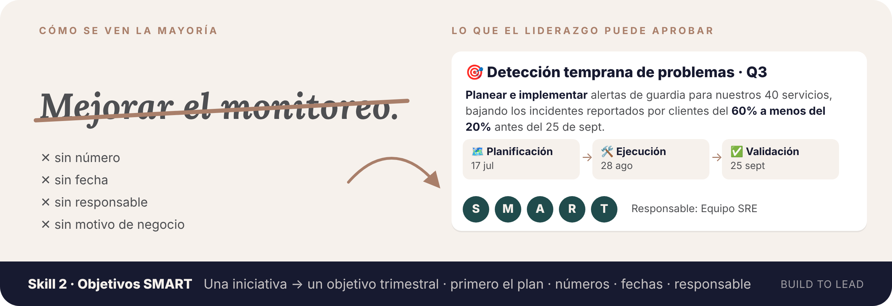

[← All skills · Todos los skills](../README.md)

<div align="center">

**[🇺🇸 English 🇬🇧](#english)** · **[🇪🇸 Español 🌎](#espanol)**

</div>

---

<a id="english"></a>

<div align="center">

# 🇺🇸 English 🇬🇧



## 🎯 Skill 2 · Tech-to-business SMART objectives

**`tech-to-business-smart-objectives`**

*One technical initiative in → one quarterly objective the business can approve and track.*

Not installed yet? [Install in 1 minute](../README.md#install-en)

</div>

Writing quarterly objectives is the task everyone postpones, and most technical objectives end up like this:

> *"Improve the data platform."* · *"Work on the migration."* · *"Optimize monitoring."*

No number, no date, no owner, no business reason, and no plan. This skill fixes that:

- 🗺️ **Planning comes first.** Every objective starts with *"Plan and implement…"*, because nothing moves without a plan.
- 👩‍💻 **Tailored to your role:** a developer is measured by features adopted and bugs reduced, SRE by availability and cost, security by exposure closed, DevRel by reach and adoption. It picks the right measure for yours.
- 📏 **SMART by design:** specific, measurable, achievable in one quarter, relevant to the business, time-bound.
- ❓ **The 6 questions answered:** what, why, when, where, who and how.
- 🧩 **One main objective + 1–3 specific ones:** planning first, then execution, then validation, each with a deliverable, a number and a date.
- 👤 **A clear owner**, so everyone knows who answers for it.
- 📈 **Expected business impact in %** (optional): performance, cost, development lifecycle, availability, security risk, customers, revenue or team time, computed from your numbers.
- ✅ **A SMART check** at the end that shows which letter still needs your input.

### 👀 Example: with gaps → placeholders

**You write:**

> *"I'm the data lead. Plan and implement the migration (phase 1 of 4) of our current data lake, with the Data, Infrastructure and Development teams. Deliverables: plan, dates, architecture, documentation and X migrated flows. It's for Q1."*

**You get:**

> 🎯 **Data platform modernization · Q1**
>
> Plan and implement phase 1 (of 4) of the migration of our current data lake to ENTER_TARGET_PLATFORM, together with the Data, Infrastructure and Development teams, migrating ENTER_NUMBER data flows by ENTER_DATE, to ENTER_BUSINESS_REASON.
>
> 📈 **Business impact (expected):** ENTER_PERCENT% less time to get data available · ENTER_PERCENT% lower data platform cost
>
> **Owner:** Data team (ENTER_OWNER)
>
> **Specific objectives:**
> 1. 🗺️ **Planning:** deliver the migration plan with dates, target architecture and documentation, approved by Data, Infrastructure and Development, by ENTER_DATE.
> 2. 🛠️ **Execution:** migrate ENTER_NUMBER phase-1 data flows to the new platform, meeting ENTER_SUCCESS_CRITERIA, by ENTER_DATE.
> 3. ✅ **Validation:** deliver the documentation of the migrated flows and the new architecture by ENTER_DATE.
>
> SMART: S ✓ · M ⚠️ ENTER_NUMBER · A ✓ · R ⚠️ ENTER_BUSINESS_REASON · T ⚠️ ENTER_DATE

It didn't know the target platform, the number of flows, the dates or **why** the business needs this, so it left them in UPPERCASE for you instead of guessing. The ⚠️ in the SMART check shows exactly what makes it not-yet-SMART.

### 👀 Example: complete

**You write:**

> *"I'm Ana Pérez, my role is SRE lead. Q3 2026, due Sep 25. Move 40 services' alerting from emails to on-call paging with runbooks, with the Backend and Support teams. Plan approved by Jul 17, all services moved by Aug 28. Today customers report 60% of incidents before we notice; goal is under 20%."*

**You get:**

> 🎯 **Early problem detection · Q3 2026**
>
> Plan and implement on-call paging with runbooks for our 40 production services, together with the Backend and Support teams, so we detect problems before customers do, reducing customer-reported incidents from 60% to under 20% by Sep 25, 2026.
>
> 📈 **Business impact (expected):** ~67% lower share of incidents reported by customers first (60% → under 20%)
>
> **Owner:** SRE team (Ana Pérez)
>
> **Specific objectives:**
> 1. 🗺️ **Planning:** deliver the rollout plan, alert ownership per service and runbook template, approved by SRE, Backend and Support, by Jul 17.
> 2. 🛠️ **Execution:** move all 40 services from email alerts to on-call paging, each with a runbook, by Aug 28.
> 3. ✅ **Validation:** customer-reported incidents below 20% of all incidents, by Sep 25.
>
> SMART: S ✓ · M ✓ · A ✓ · R ✓ · T ✓

### 👀 More examples by role

<details>
<summary><b>👩‍💻 Frontend developer</b></summary>

**You write:**

> *"I'm a frontend developer. Q2. The checkout page takes 6 seconds to load on mobile, and 70% of our traffic is mobile. Goal: under 3 seconds by June 15, with Design and Backend. We'll measure mobile checkout conversion."*

**You get:**

```
🎯 Faster checkout for mobile customers · Q2

Plan and implement performance improvements to our mobile checkout page, together with the Design and Backend teams, reducing its load time from 6 to under 3 seconds by June 15, because 70% of our traffic comes from mobile, and measuring the effect on mobile checkout conversion (today: ENTER_PERCENT).

📈 Business impact (expected): 50% faster mobile checkout (6 → 3 s) · ENTER_PERCENT% higher mobile checkout conversion

Owner: Frontend team (ENTER_OWNER)

Specific objectives:
1. 🗺️ Planning: deliver the improvement plan with priorities and dates, approved by Frontend, Design and Backend, by ENTER_DATE.
2. 🛠️ Execution: mobile checkout page loads in under 3 seconds, by June 15.
3. ✅ Validation: report mobile checkout conversion before vs. after the change, by ENTER_DATE.
```

SMART: S ✓ · M ✓ · A ✓ · R ✓ · T ⚠️ ENTER_DATE

</details>

<details>
<summary><b>🛡️ Cybersecurity</b></summary>

**You write:**

> *"I'm a cybersecurity analyst. Q4. We have 120 critical vulnerabilities open on internet-facing servers, open 45 days on average. We want no critical one open more than 15 days by December 15, with Infrastructure and Development, to be ready for the ISO 27001 audit in January."*

**You get:**

```
🎯 Security strengthening · Q4

Plan and implement the remediation of the 120 critical vulnerabilities open on our internet-facing servers, together with the Infrastructure and Development teams, going from 45 days of average exposure to no critical vulnerability open more than 15 days by December 15, to be ready for the ISO 27001 (security certification) audit in January.

📈 Business impact (expected): at least 67% less exposure time to critical vulnerabilities (45 → at most 15 days)

Owner: Cybersecurity team (ENTER_OWNER)

Specific objectives:
1. 🗺️ Planning: deliver the remediation plan with priorities, owners and maintenance windows, approved by Cybersecurity, Infrastructure and Development, by ENTER_DATE.
2. 🛠️ Execution: remediate the 120 critical vulnerabilities, with none open more than 15 days, by December 15.
3. ✅ Validation: deliver the remediation evidence for the ISO 27001 audit by ENTER_DATE.
```

SMART: S ✓ · M ✓ · A ✓ · R ✓ · T ⚠️ ENTER_DATE

</details>

<details>
<summary><b>📊 BI analyst</b></summary>

**You write:**

> *"I'm a BI analyst. Q1 2027. Finance builds the monthly close report by hand in spreadsheets and it takes 5 days. I want an automated dashboard so it takes 1 day, by March 20, with Finance and Data Engineering."*

**You get:**

```
🎯 Faster monthly close for Finance · Q1 2027

Plan and implement an automated monthly close dashboard for the Finance team, together with Finance and Data Engineering, reducing the time to prepare the monthly close report from 5 days to 1 by March 20, 2027, freeing 4 days of Finance's work every month.

📈 Business impact (expected): 80% less time to close the month (5 → 1 day) · 4 days of Finance's work freed per month

Owner: BI team (ENTER_OWNER)

Specific objectives:
1. 🗺️ Planning: agree the report's metrics, data sources and delivery dates, approved by Finance and Data Engineering, by ENTER_DATE.
2. 🛠️ Execution: publish the automated monthly close dashboard, by ENTER_DATE.
3. ✅ Validation: Finance closes one month using the dashboard in 1 day, by March 20, 2027.
```

SMART: S ✓ · M ✓ · A ✓ · R ✓ · T ⚠️ ENTER_DATE

</details>

<details>
<summary><b>🧠 Machine learning engineer</b></summary>

**You write:**

> *"My role is ML engineer. Q3. Our fraud model catches 70% of fraudulent payments; we want 85% without blocking more than 1% of legitimate payments. With Payments and Risk teams."*

**You get:**

```
🎯 Fraud prevention · Q3

Plan and implement improvements to our payments fraud detection model, together with the Payments and Risk teams, increasing detected fraudulent payments from 70% to 85% while keeping wrongly blocked legitimate payments at or below 1%, by ENTER_DATE, to ENTER_BUSINESS_REASON.

📈 Business impact (expected): ~21% more fraudulent payments detected (70% → 85%) · USD ENTER_AMOUNT in fraud losses avoided

Owner: ML team (ENTER_OWNER)

Specific objectives:
1. 🗺️ Planning: deliver the model improvement plan, data needed and success thresholds, approved by Payments and Risk, by ENTER_DATE.
2. 🛠️ Execution: put the improved model in production, by ENTER_DATE.
3. ✅ Validation: 85% of fraudulent payments detected with at most 1% of legitimate payments blocked, by ENTER_DATE.
```

SMART: S ✓ · M ✓ · A ✓ · R ⚠️ ENTER_BUSINESS_REASON (e.g. fraud losses in USD) · T ⚠️ ENTER_DATE

</details>

### 🚀 Use it

Start a new chat and **begin with your role** ("I'm a…" / "My role is…"):

> *"**I'm a backend developer.** Help me write my Q1 objective: I want to …"*

You don't need to name the skill. To call it explicitly, type `/` and pick **tech-to-business-smart-objectives** (in Claude Code: `/tech-business-skills:tech-to-business-smart-objectives`). One objective per answer; ask again for the next one.

How it climbs from "what I did" to "why it matters": see the [translation ladder](../tech-to-business-short-report/README.md#-from-what-i-did-to-why-it-matters).

<br>

---

<a id="espanol"></a>

<div align="center">

# 🇪🇸 Español 🌎

🇲🇽 🇨🇴 🇦🇷 🇨🇱 🇵🇪 🇻🇪 🇪🇨 🇧🇴 🇺🇾 🇵🇾 🇨🇷 🇵🇦 🇬🇹 🇭🇳 🇸🇻 🇳🇮 🇨🇺 🇩🇴 🇵🇷



## 🎯 Skill 2 · Objetivos SMART de técnico a negocio

**`tech-to-business-smart-objectives`**

*Entra una iniciativa técnica → sale un objetivo trimestral que el negocio puede aprobar y seguir.*

¿Aún no lo tienes? [Instálalo en 1 minuto](../README.md#install-es)

</div>

Escribir los objetivos del trimestre es la tarea que todos posponen, y la mayoría de los objetivos técnicos terminan así:

> *"Mejorar la plataforma de datos."* · *"Avanzar con la migración."* · *"Optimizar el monitoreo."*

Sin número, sin fecha, sin responsable, sin motivo de negocio y sin plan. Este skill lo arregla:

- 🗺️ **Primero el plan.** Todo objetivo empieza con *"Planear e implementar…"*, porque sin plan nada avanza.
- 👩‍💻 **A la medida de tu rol:** a desarrollo se le mide por funcionalidades adoptadas y bugs reducidos, a SRE por disponibilidad y costo, a seguridad por exposición cerrada, a DevRel por alcance y adopción. Escoge la medida correcta para el tuyo.
- 📏 **SMART desde el diseño:** específico, medible, alcanzable en un trimestre, relevante para el negocio y con fecha.
- ❓ **Las 6 preguntas respondidas:** qué, por qué, cuándo, dónde, quién y cómo.
- 🧩 **Un objetivo principal + 1–3 específicos:** primero planificación, después ejecución y al final validación, cada uno con entregable, número y fecha.
- 👤 **Un responsable claro**, para que todos sepan quién responde por él.
- 📈 **Impacto esperado en el negocio en %** (opcional): rendimiento, costo, ciclo de desarrollo, disponibilidad, riesgo de seguridad, clientes, ingresos o tiempo del equipo, calculado con tus números.
- ✅ **Un chequeo SMART** al final que muestra qué letra todavía necesita tu información.

### 👀 Ejemplo: con vacíos → marcadores

**Escribes:**

> *"Soy líder de datos. Planear e implementar la migración (fase 1 de 4) de nuestro data lake actual, con los equipos de Datos, Infraestructura y Desarrollo. Entregables: plan, fechas, arquitectura, documentación y X flujos migrados. Es para el Q1."*

**Recibes:**

> 🎯 **Modernización de la plataforma de datos · Q1**
>
> Planear e implementar la fase 1 (de 4) de la migración de nuestro data lake actual a INGRESA_PLATAFORMA_DESTINO, junto a los equipos de Datos, Infraestructura y Desarrollo, migrando INGRESA_CANTIDAD flujos de datos antes del INGRESA_FECHA, para INGRESA_MOTIVO_DE_NEGOCIO.
>
> 📈 **Impacto en el negocio (esperado):** INGRESA_PORCENTAJE% menos tiempo para tener los datos disponibles · INGRESA_PORCENTAJE% menos costo de la plataforma de datos
>
> **Responsable:** Equipo de Datos (INGRESA_RESPONSABLE)
>
> **Objetivos específicos:**
> 1. 🗺️ **Planificación:** entregar el plan de migración con fechas, arquitectura destino y documentación, aprobado por Datos, Infraestructura y Desarrollo, antes del INGRESA_FECHA.
> 2. 🛠️ **Ejecución:** migrar INGRESA_CANTIDAD flujos de datos de la fase 1 a la nueva plataforma, cumpliendo INGRESA_CRITERIO_DE_EXITO, antes del INGRESA_FECHA.
> 3. ✅ **Validación:** entregar la documentación de los flujos migrados y de la nueva arquitectura antes del INGRESA_FECHA.
>
> SMART: S ✓ · M ⚠️ INGRESA_CANTIDAD · A ✓ · R ⚠️ INGRESA_MOTIVO_DE_NEGOCIO · T ⚠️ INGRESA_FECHA

No sabía la plataforma destino, la cantidad de flujos, las fechas ni **por qué** el negocio necesita esto, así que los dejó en MAYÚSCULAS para ti en vez de adivinar. Los ⚠️ del chequeo SMART muestran exactamente qué le falta para ser SMART.

### 👀 Ejemplo: completo

**Escribes:**

> *"Soy Ana Pérez, mi rol es líder de SRE. Q3 2026, cierra el 25 de septiembre. Pasar las alertas de 40 servicios de correos a guardias con paging y runbooks, junto a los equipos de Backend y Soporte. Plan aprobado antes del 17 de julio, todos los servicios migrados antes del 28 de agosto. Hoy los clientes reportan el 60% de los incidentes antes de que nos demos cuenta; la meta es menos del 20%."*

**Recibes:**

> 🎯 **Detección temprana de problemas · Q3 2026**
>
> Planear e implementar alertas de guardia con runbooks para nuestros 40 servicios en producción, junto a los equipos de Backend y Soporte, para detectar los problemas antes que los clientes, bajando los incidentes reportados por clientes del 60% a menos del 20% antes del 25 de septiembre de 2026.
>
> 📈 **Impacto en el negocio (esperado):** ~67% menos incidentes reportados primero por los clientes (60% → menos del 20%)
>
> **Responsable:** Equipo SRE (Ana Pérez)
>
> **Objetivos específicos:**
> 1. 🗺️ **Planificación:** entregar el plan de despliegue, el dueño de las alertas de cada servicio y la plantilla de runbook, aprobado por SRE, Backend y Soporte, antes del 17 de julio.
> 2. 🛠️ **Ejecución:** pasar los 40 servicios de alertas por correo a guardias con paging, cada uno con su runbook, antes del 28 de agosto.
> 3. ✅ **Validación:** incidentes reportados por clientes por debajo del 20% del total, antes del 25 de septiembre.
>
> SMART: S ✓ · M ✓ · A ✓ · R ✓ · T ✓

### 👀 Más ejemplos por rol

<details>
<summary><b>👩‍💻 Desarrollo frontend</b></summary>

**Escribes:**

> *"Soy desarrolladora frontend. Q2. La página de checkout tarda 6 segundos en cargar en el celular, y el 70% de nuestro tráfico es móvil. Meta: menos de 3 segundos antes del 15 de junio, con Diseño y Backend. Vamos a medir la conversión del checkout móvil."*

**Recibes:**

```
🎯 Checkout más rápido para clientes en el celular · Q2

Planear e implementar mejoras de rendimiento en nuestra página de checkout móvil, junto a los equipos de Diseño y Backend, bajando su tiempo de carga de 6 a menos de 3 segundos antes del 15 de junio, porque el 70% de nuestro tráfico viene del celular, y midiendo el efecto en la conversión del checkout móvil (hoy: INGRESA_PORCENTAJE).

📈 Impacto en el negocio (esperado): checkout móvil 50% más rápido (6 → 3 s) · INGRESA_PORCENTAJE% más conversión en el checkout móvil

Responsable: Equipo Frontend (INGRESA_RESPONSABLE)

Objetivos específicos:
1. 🗺️ Planificación: entregar el plan de mejoras con prioridades y fechas, aprobado por Frontend, Diseño y Backend, antes del INGRESA_FECHA.
2. 🛠️ Ejecución: la página de checkout móvil carga en menos de 3 segundos, antes del 15 de junio.
3. ✅ Validación: reportar la conversión del checkout móvil antes y después del cambio, antes del INGRESA_FECHA.
```

SMART: S ✓ · M ✓ · A ✓ · R ✓ · T ⚠️ INGRESA_FECHA

</details>

<details>
<summary><b>🛡️ Ciberseguridad</b></summary>

**Escribes:**

> *"Soy analista de ciberseguridad. Q4. Hoy tenemos 120 vulnerabilidades críticas abiertas en servidores expuestos a internet, en promedio 45 días abiertas. Queremos que no quede ninguna crítica con más de 15 días antes del 15 de diciembre, junto a Infraestructura y Desarrollo, para llegar bien a la auditoría ISO 27001 de enero."*

**Recibes:**

```
🎯 Fortalecimiento de la seguridad · Q4

Planear e implementar la remediación de las 120 vulnerabilidades críticas abiertas en nuestros servidores expuestos a internet, junto a los equipos de Infraestructura y Desarrollo, pasando de 45 días promedio de exposición a ninguna crítica con más de 15 días abierta antes del 15 de diciembre, para llegar preparados a la auditoría ISO 27001 (certificación de seguridad) de enero.

📈 Impacto en el negocio (esperado): al menos 67% menos tiempo de exposición a vulnerabilidades críticas (45 → máximo 15 días)

Responsable: Equipo de Ciberseguridad (INGRESA_RESPONSABLE)

Objetivos específicos:
1. 🗺️ Planificación: entregar el plan de remediación con prioridades, responsables y ventanas de mantenimiento, aprobado por Ciberseguridad, Infraestructura y Desarrollo, antes del INGRESA_FECHA.
2. 🛠️ Ejecución: remediar las 120 vulnerabilidades críticas, sin ninguna con más de 15 días abierta, antes del 15 de diciembre.
3. ✅ Validación: entregar la evidencia de remediación para la auditoría ISO 27001 antes del INGRESA_FECHA.
```

SMART: S ✓ · M ✓ · A ✓ · R ✓ · T ⚠️ INGRESA_FECHA

</details>

<details>
<summary><b>📊 Analista de BI</b></summary>

**Escribes:**

> *"Soy analista de BI. Q1 2027. Finanzas arma el reporte de cierre mensual a mano en planillas y le toma 5 días. Quiero un tablero automático para que tome 1 día, antes del 20 de marzo, con Finanzas e Ingeniería de Datos."*

**Recibes:**

```
🎯 Cierre mensual más rápido para Finanzas · Q1 2027

Planear e implementar un tablero automático de cierre mensual para el equipo de Finanzas, junto a Finanzas e Ingeniería de Datos, bajando el tiempo de preparación del reporte de cierre mensual de 5 días a 1 antes del 20 de marzo de 2027, liberando 4 días de trabajo de Finanzas cada mes.

📈 Impacto en el negocio (esperado): 80% menos tiempo para cerrar el mes (5 → 1 día) · 4 días de trabajo de Finanzas liberados al mes

Responsable: Equipo de BI (INGRESA_RESPONSABLE)

Objetivos específicos:
1. 🗺️ Planificación: acordar las métricas del reporte, las fuentes de datos y las fechas de entrega, aprobado por Finanzas e Ingeniería de Datos, antes del INGRESA_FECHA.
2. 🛠️ Ejecución: publicar el tablero automático de cierre mensual, antes del INGRESA_FECHA.
3. ✅ Validación: Finanzas cierra un mes usando el tablero en 1 día, antes del 20 de marzo de 2027.
```

SMART: S ✓ · M ✓ · A ✓ · R ✓ · T ⚠️ INGRESA_FECHA

</details>

<details>
<summary><b>🧠 Ingeniería de machine learning</b></summary>

**Escribes:**

> *"Mi rol es ingeniera de ML. Q3. Nuestro modelo de fraude detecta el 70% de los pagos fraudulentos; queremos 85% sin bloquear más del 1% de los pagos legítimos. Con los equipos de Pagos y Riesgo."*

**Recibes:**

```
🎯 Prevención de fraude · Q3

Planear e implementar mejoras en nuestro modelo de detección de fraude en pagos, junto a los equipos de Pagos y Riesgo, subiendo los pagos fraudulentos detectados del 70% al 85% y manteniendo los pagos legítimos bloqueados por error en 1% o menos, antes del INGRESA_FECHA, para INGRESA_MOTIVO_DE_NEGOCIO.

📈 Impacto en el negocio (esperado): ~21% más pagos fraudulentos detectados (70% → 85%) · USD INGRESA_MONTO en pérdidas por fraude evitadas

Responsable: Equipo de ML (INGRESA_RESPONSABLE)

Objetivos específicos:
1. 🗺️ Planificación: entregar el plan de mejora del modelo, los datos necesarios y los umbrales de éxito, aprobado por Pagos y Riesgo, antes del INGRESA_FECHA.
2. 🛠️ Ejecución: poner el modelo mejorado en producción, antes del INGRESA_FECHA.
3. ✅ Validación: 85% de los pagos fraudulentos detectados con máximo 1% de pagos legítimos bloqueados, antes del INGRESA_FECHA.
```

SMART: S ✓ · M ✓ · A ✓ · R ⚠️ INGRESA_MOTIVO_DE_NEGOCIO (por ejemplo, pérdidas por fraude en USD) · T ⚠️ INGRESA_FECHA

</details>

### 🚀 Úsalo

Abre un chat nuevo y **empieza con tu rol** ("Soy…" / "Mi rol es…"):

> *"**Soy desarrolladora backend.** Ayúdame a redactar mi objetivo del Q1: quiero …"*

No necesitas nombrar el skill. Para llamarlo directo, escribe `/` y elige **tech-to-business-smart-objectives** (en Claude Code: `/tech-business-skills:tech-to-business-smart-objectives`). Un objetivo por respuesta; pide el siguiente después.

Cómo sube de "lo que hice" a "por qué importa": mira la [escalera de traducción](../tech-to-business-short-report/README.md#-de-lo-que-hice-a-por-qué-importa).
